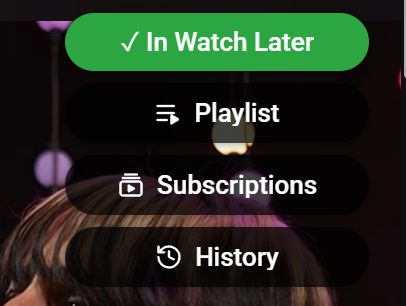
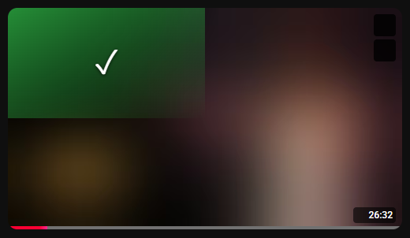

# Watch Later Toggle

Chrome extension that adds one-click Watch Later toggles to YouTube - a button on watch pages and a hover button on every video thumbnail - plus quick links to Watch Later, Subscriptions and History.

  
  

## Install

1. Open `chrome://extensions` and enable **Developer mode**
2. Click **Load unpacked** and select this folder

## Links

| Page | Tiles |
|---|---|
| `/watch` | Playlist, Subscriptions, History (on hovering the toggle button) |
| `/` (home) | Playlist, Subscriptions, History |
| `/playlist?list=WL` | Subscriptions, History |
| `/feed/subscriptions` | Playlist, History |
| any other page | Playlist, Subscriptions |
| `/embed/*` | nothing |

Tiles are real links, so middle-click or ctrl-click opens a new tab.

## States

| Watch button | Card button | Meaning |
|---|---|---|
| `+ Watch Later` | `+` | not saved - click to add |
| `✓ In Watch Later` (green) | `✓` (green) | saved - click to remove |
| `Watch Later…` (dimmed) | `…` | checking |
| `Failed - try again` (red) | `!` (red) | edit failed and reverted - click to retry |
| `⟳ Watch Later` (red text) | `⟳` | state check failed - click to retry |

The card button covers the left half of small thumbnails, and only the top-left quarter of large ones so the preview scrub bar stays usable.

## How it works

- MAIN-world content script, authenticated with the page's own cookies plus a `SAPISIDHASH` header - no OAuth, no extension permissions
- Membership comes from listing Watch Later (`browse`, `VLWL`), cached for 5 minutes and patched on each toggle
- Toggles call `browse/edit_playlist` against playlist `WL`, optimistically with revert on failure

Design rationale and ruled-out approaches are in `CLAUDE.md`.

## Caveats

- Relies on YouTube's unofficial InnerTube API, which can change without notice
- Listing stops at 50 pages (~5000 videos); anything beyond shows as not saved
- Changes made outside the extension can show stale for up to 5 minutes
- Chrome 111+ only (needed for MAIN-world content scripts); tested in Chrome, should work in Edge and Brave
